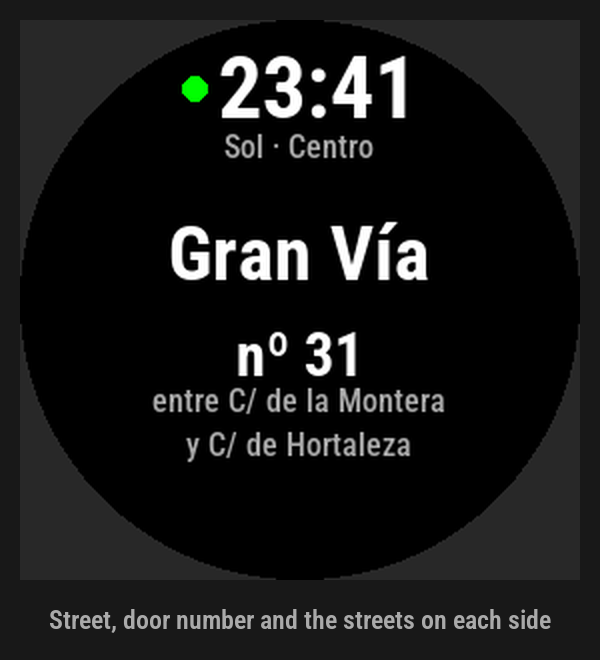

# CALLE

Callejero sin conexión para relojes Garmin fēnix (app de Connect IQ). Al abrirla dice en qué calle está,
el número del portal más cercano y entre qué calles, sin teléfono ni cobertura: el callejero viaja dentro
de la app y la posición no sale nunca del reloj.

> **English.** CALLE is an offline street finder for Garmin fēnix watches. It shows the street you are on,
> the nearest door number and the cross streets on each side. The street data ships inside the app, it
> needs no phone or network, and your position never leaves the watch. Areas: Santiago de Compostela and
> Madrid (Spain). The interface is in Spanish.



## Qué hace

- **La calle, el portal más cercano y el tramo** («entre C/ de la Montera y C/ de Hortaleza»). En un cruce
  da la esquina, y si duda entre dos paralelas muestra las dos («DOS CALLES»).
- **Barrio y distrito** en Madrid; **barrio, lugar y parroquia** en Santiago y su entorno. Si no hay calle
  a 50 m, el lugar más cercano.
- **Hospital con urgencias y comisaría más cercanos.** Flecha y anillo de brújula, con el destino marcado
  en el anillo, y distancia en línea recta. No hay ruta por calles.
- **Anotaciones con START:** hora, lugar y coordenadas, guardadas en el reloj. Desde el menú, «Ir aquí»
  guía de vuelta a cualquiera de ellas.
- **Coordenadas UTM**, redondeadas como las del propio reloj.
- **Zona del callejero** automática por la posición, o fija desde el menú del reloj o desde Garmin Connect.
- **Hora grande**, para usarla también como reloj.

## Privacidad

- El manifiesto pide **solo `Positioning`**. Sin el permiso `Communications`, la plataforma no deja hacer
  peticiones de red: la app no puede enviar la posición a ningún sitio.
- **No graba actividades** ni ficheros FIT.
- Solo guarda en el reloj las anotaciones (hasta que el usuario las borra) y la zona elegida.
- `./ciq.sh privacidad` falla si el código usa red, grabación o segundo plano, o si algo fuera de
  `source/Notas.mc` y `source/Ajustes.mc` guarda en el reloj. Se ejecuta solo antes de `release`,
  `package`, `beta`, `prg6x` e `instalar`.

## Relojes y zonas

| Reloj | Zonas |
|---|---|
| fēnix 7X Pro (y su variante sin Wi-Fi) | Santiago de Compostela y alrededores; término municipal de Madrid |
| fēnix 6X Pro | una parte de Madrid |

El fēnix 6X no admite más de 254 recursos de datos por app, así que lleva datos compactos y solo los
distritos de `compacta.distritos` en `tools/regiones.json`.

Para **añadir una ciudad**, se describe la región en `tools/regiones.json` y se ejecuta
`REGION=<nombre> ./ciq.sh datos`. Los puntos de control salen con `REGION=<nombre> ./ciq.sh ref --derivar`.

## Datos y licencias

- **El código** está bajo licencia MIT (`LICENSE`).
- **El callejero no está en el repositorio:** lo genera `./ciq.sh datos` (`tools/build_callejero.py`) a
  partir de tres fuentes:

  | Fuente | Qué aporta | Licencia y atribución |
  |---|---|---|
  | OpenStreetMap, vía Overpass | calles, plazas, portales, barrios, lugares, parroquias, hospitales y comisarías | ODbL 1.0 · «© colaboradores de OpenStreetMap» |
  | Dirección General del Catastro (WFS INSPIRE de direcciones) | números de portal que OSM no tiene, en la caja `catastro` de cada región | uso libre citando la fuente · «Fuente: Dirección General del Catastro» |
  | Ayuntamiento de Madrid, datos.madrid.es, conjunto 213605 («Relación de direcciones vigentes, con coordenadas») | números de portal de Madrid | CC BY 4.0 · «Fuente: Ayuntamiento de Madrid (datos.madrid.es)» |

  Los nombres de calle siempre son los de OSM. Las fuentes oficiales solo rellenan números.
- **El callejero que viaja en la app es una base de datos derivada de OpenStreetMap** y se rige por la
  ODbL. Para cumplir su apartado 4.6, este repositorio ofrece el método completo para obtenerla a partir
  de las fuentes:
  - el generador, `tools/build_callejero.py`;
  - la configuración de cada región, `tools/regiones.json`;
  - las correcciones locales, `tools/overrides-*.json`.
- **Roboto Condensed** (`tools/fonts/`) va bajo SIL Open Font License 1.1 (`tools/fonts/OFL.txt`). Solo la
  usan las maquetas (`tools/mockup.py`); en el reloj se usan las fuentes del propio reloj.

## Compilar

`ciq.sh` está escrito para macOS. Necesita:

- el **SDK de Connect IQ**, instalado con SdkManager, con los dispositivos fēnix 7X Pro y fēnix 6X Pro;
- **Java 21** (si existe, se usa el `openjdk@21` de Homebrew);
- **Python 3**: el generador solo usa la biblioteca estándar, y `./ciq.sh icon` y `tools/mockup.py` además
  necesitan Pillow. Para usar otro intérprete: `PY=/ruta/a/python3`;
- **curl**;
- una **clave de desarrollador** de Connect IQ en `~/.garmin/developer_key.der`, o en otra ruta con
  `KEY=/ruta/a/la/clave.der`.

```sh
# 1. Callejero. Descarga de Overpass y del Catastro; se guarda en tools/cache/.
REGION=santiago ./ciq.sh datos
REGION=madrid ./ciq.sh datos        # antes, el CSV del Ayuntamiento (ver abajo)

# 2. Referencia en Python (fuerza bruta) y vectores para los tests de Monkey C
REGION=santiago ./ciq.sh ref --gen-tests
REGION=madrid ./ciq.sh ref --gen-tests

# 3. Tests en el simulador y compilación
./ciq.sh test
./ciq.sh release                    # → bin/calle-release.prg
```

**fēnix 6X:**

```sh
VARIANTE=6x REGION=madrid ./ciq.sh datos
VARIANTE=6x REGION=madrid ./ciq.sh ref --gen-tests
DEV=fenix6xpro ./ciq.sh test
./ciq.sh prg6x                      # → bin/calle-fenix6x.prg
```

**Portales de Madrid.** Se descarga a mano el CSV del conjunto 213605 de datos.madrid.es y se guarda como
`tools/cache/madrid-ayto/direccionesvigentes_AAAAMMDD.csv`. Después se apunta a él en
`portales_ayto_madrid`, dentro de `tools/regiones.json`.

**Actualizar los datos** (conviene cada trimestre): `REGION=<región> ./ciq.sh datos --refresh` y, después,
los pasos 2 y 3.

Las carpetas `resources-gen*/`, `source-gen*/` y `test-gen*/` son resultado de los pasos 1 y 2, y no están
en el repositorio.

## Instalar por cable

- **macOS:** `./ciq.sh instalar` compila y copia la app a `GARMIN/Apps` por MTP. Hay que conectar el reloj
  directamente al Mac, no a un dock, y tener Garmin Express cerrado. Usa `tools/mtp_enviar.c`, que
  necesita libmtp (`brew install libmtp`).
- **Windows:** el reloj aparece como una unidad. Basta con copiar el `.prg` a `GARMIN/APPS`.

## Estructura

| Carpeta | Contenido |
|---|---|
| `source/` | la app, en Monkey C. Todos los umbrales están en `L.mc` |
| `test/` | tests de Monkey C (`./ciq.sh test`) |
| `tools/` | generador del callejero, referencia en Python, maquetas, icono y envío por MTP |
| `resources/` | icono y cadenas |
| `docs/specs/` | diseño de cada versión, con los cambios y su motivo |
| `docs/tienda/` | textos e imágenes de la ficha de la Connect IQ Store |

## Aviso

Herramienta de apoyo, sin garantía (véase `LICENSE`). Los datos de OpenStreetMap y de las fuentes
oficiales pueden tener errores u omisiones. La guía a hospitales y comisarías es en línea recta, no por
calles. Compruebe siempre la dirección antes de darla por buena. CALLE no está afiliada a Garmin ni a
ningún organismo público.
